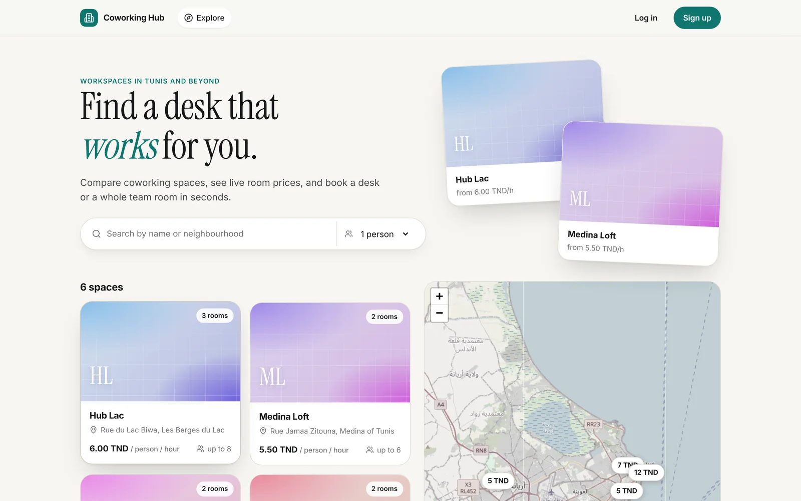
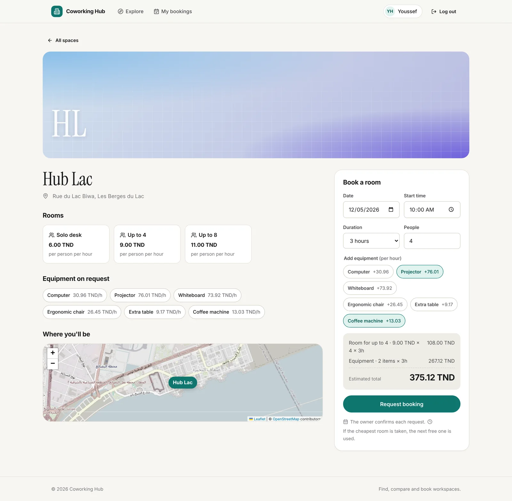
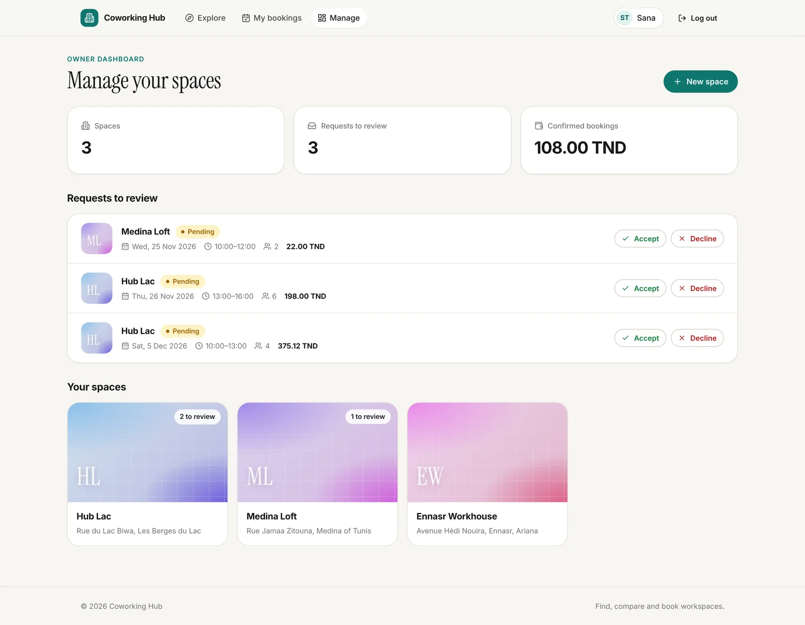
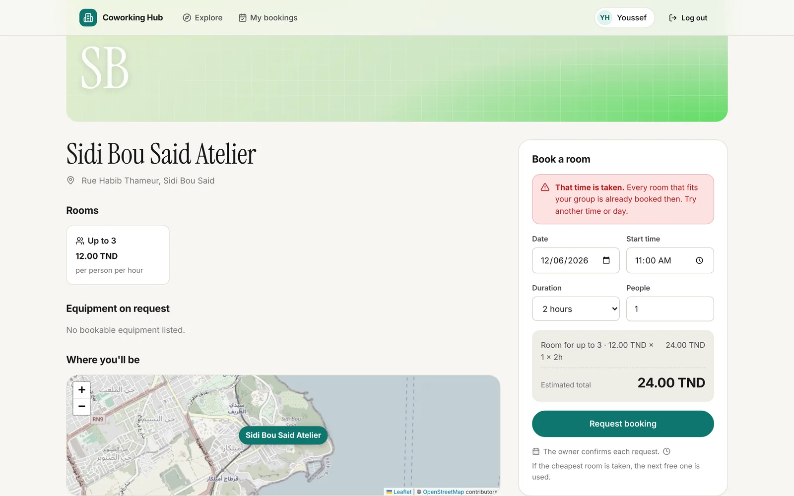
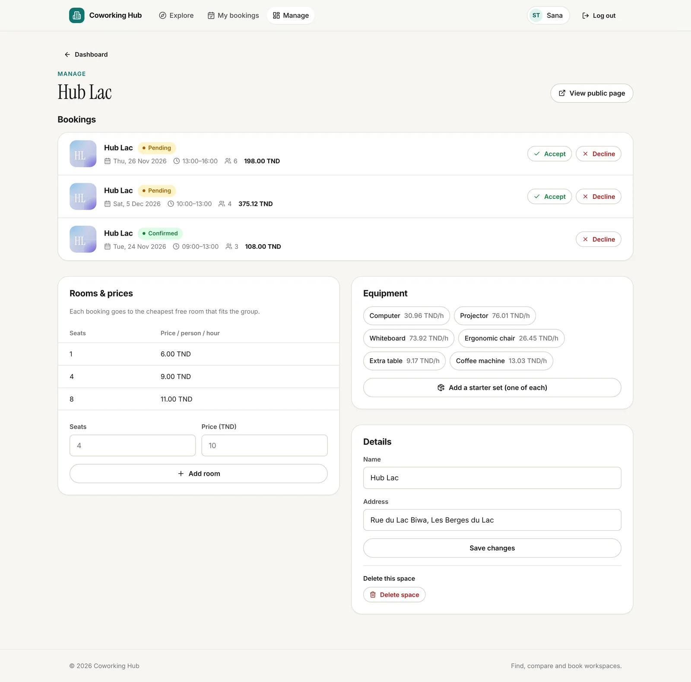
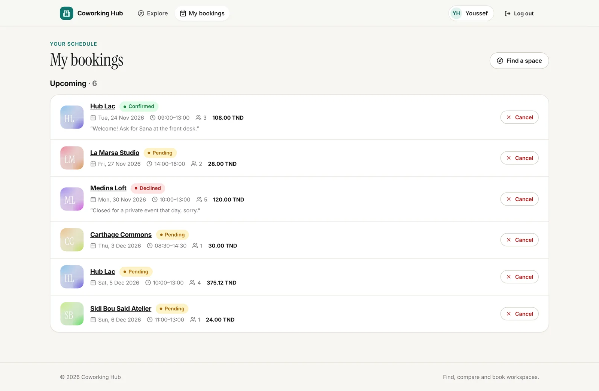
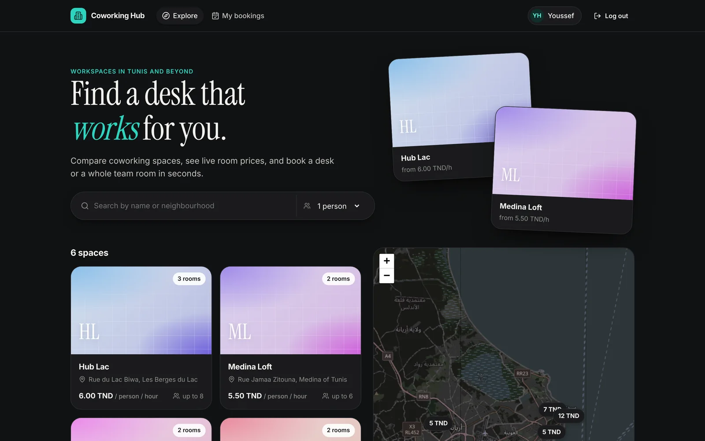
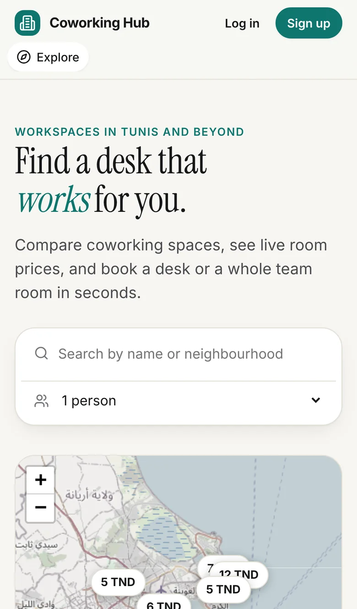
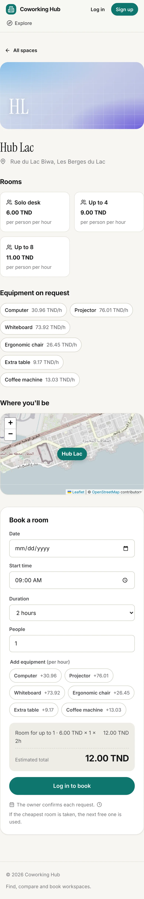

# Coworking-Hub



## Objective

Coworking-Hub is designed to streamline the process of finding, reserving, and utilizing coworking spaces. It caters to freelancers, entrepreneurs, and businesses seeking flexible and productive work environments. By centralizing various coworking options, users can effortlessly compare spaces, book amenities, and connect with like-minded professionals.

## Tools and Technologies

To build a robust and scalable application, we employed a combination of modern and efficient technologies:

- **React + TypeScript web app** (`web/`): the current front end. Responsive (phone to desktop), light and dark themes, map of spaces, live price estimates, booking, and an owner dashboard. See [web/README.md](web/README.md).

- **Flutter**: the original mobile prototype (`app-release.apk`, screenshots in `UI/`, `demo.mp4`). Its source code is not in this repository, and the prototype does not call the API.

- **Spring Boot**: Powers the backend services, offering a straightforward approach to setting up and running web applications. It is the backbone that handles business logic, user authentication, and data processing.

- **PostgreSQL**: Our chosen database for secure and reliable storage of all application data, including user profiles, reservations, and space details. It provides comprehensive features and is well-suited for handling complex queries and transactions.

## Web app

| | |
|---|---|
|  |  |
| Space page: rooms, equipment and a live price estimate | Owner dashboard: requests to review, confirmed revenue, spaces |
|  |  |
| Double bookings are refused with a clear message | Managing rooms, prices, equipment and bookings |
|  |  |
| A member's bookings and their status | Dark mode follows the system setting |

<p>
  
  
</p>

**Demo videos:** [web walkthrough](docs/demo/web-walkthrough.mp4) (a member books a room, the owner accepts it) · [API walkthrough](docs/demo/api-walkthrough.mp4) (ownership 403s, double-booking 409, every request real).

Quick start with demo data, once the backend below is running:

```bash
cd web
npm install
npm run seed
npm run dev
```

Then open http://localhost:5173 and log in as `youssef@demo.coworkinghub.tn` (member) or `sana@demo.coworkinghub.tn` (owner), password `demo-pass-123`.

## Running the backend

The Spring Boot API lives in `coworkinghub/` (Java 21, Spring Boot 3.5). Configuration comes from environment variables:

| Variable | Default | Purpose |
|---|---|---|
| `DB_URL` | `jdbc:postgresql://localhost:5432/postgres` | PostgreSQL JDBC URL |
| `DB_USERNAME` | `postgres` | Database user |
| `DB_PASSWORD` | *(empty)* | Database password |
| `JWT_SECRET` | *(random per start)* | HS256 signing key, at least 32 bytes. Set it in production, or tokens stop working after a restart |
| `JWT_EXPIRATION` | `PT24H` | Token lifetime (ISO-8601 duration) |
| `APP_SECURITY_REQUIRE_AUTH` | `false` | `true` also requires a token to browse spaces, rooms and equipment |
| `APP_ADMIN_EMAIL` / `APP_ADMIN_PASSWORD` | *(unset)* | Creates the first ADMIN account at startup if no account has that email |
| `SERVER_PORT` | `8081` | HTTP port |

```bash
cd coworkinghub
DB_PASSWORD=your-password JWT_SECRET=$(openssl rand -hex 32) ./mvnw spring-boot:run
```

Tests use an in-memory H2 database and need no PostgreSQL server: `./mvnw test`.

### Authentication and access rules

`POST /api/auth/register` and `POST /api/auth/login` return `{ "token": "...", "user": {...} }`. Send the token as `Authorization: Bearer <token>`. Passwords are stored as BCrypt hashes and never returned. Accounts can self-register as `USER` or `OWNER`; `ADMIN` accounts come from `APP_ADMIN_EMAIL`/`APP_ADMIN_PASSWORD` or are created by another admin.

| Action | Allowed for |
|---|---|
| Browse spaces, rooms, equipment | Anyone (a token is needed only with `APP_SECURITY_REQUIRE_AUTH=true`) |
| Create a coworking space | OWNER and ADMIN accounts; the caller becomes its owner |
| Edit or delete a space, add rooms or equipment | The space's owner, or an ADMIN |
| Book | Any logged-in account; the reservation belongs to the caller |
| See a reservation | The person who booked it, the space's owner, or an ADMIN |
| Accept or decline a reservation | The space's owner, or an ADMIN |
| Cancel a reservation | The person who booked it, the space's owner, or an ADMIN |
| Edit a profile, see its email | The account itself, or an ADMIN (others see the profile without email) |
| `POST /api/users/` (create any account type) | ADMIN only |

Missing or invalid token: `401`. Not allowed: `403`.

### Booking and pricing

A reservation needs `date` (`yyyy-MM-dd`), `time` (`HH:mm`), `hours`, `numberOfPeople` and `coworkingSpaceId`, and must end by midnight. It is placed in the cheapest room that can hold `numberOfPeople` **and is free for the whole slot** (declined reservations do not hold a room):
`totalPrice = (room.pricePerPersonPerHour × numberOfPeople + sum of equipment prices) × hours`.

- No room big enough: `400`.
- Every big-enough room already booked for an overlapping slot: `409`.
- Back-to-back bookings (one ends at 12:00, the next starts at 12:00) are allowed.
- The room row is locked while it is checked, so simultaneous requests cannot book the same slot twice.
- Re-accepting a declined reservation whose slot has since been taken: `409`.

### API

| Method | Path | Description |
|---|---|---|
| `POST` | `/api/auth/register` | Create an account (USER or OWNER) and get a token |
| `POST` | `/api/auth/login` | Log in and get a token |
| `POST` | `/api/users/` | Create an account of any type (admin only) |
| `GET` | `/api/users/me` | The authenticated account |
| `GET` / `PUT` | `/api/users/{id}` | Read / update a profile |
| `GET` / `POST` | `/api/coworking-spaces/` | List / create coworking spaces |
| `GET` / `PUT` / `DELETE` | `/api/coworking-spaces/{id}` | Read / update / delete a space (`409` while it still has rooms, equipment or reservations) |
| `GET` / `POST` | `/api/coworking-spaces/{id}/rooms` | List / add rooms (`capacity`, `pricePerPersonPerHour`) |
| `GET` | `/api/coworking-spaces/{id}/equipment` | List a space's equipment |
| `POST` | `/api/coworking-spaces/{id}/add-random-equipment` | Add one sample item of each equipment type |
| `GET` / `POST` | `/api/reservations/` | List (your own by default; `?coworkingSpaceId=` for a space you own; admins may also use `?userId=`) / create a reservation |
| `GET` | `/api/reservations/me` | The authenticated account's reservations |
| `GET` / `DELETE` | `/api/reservations/{id}` | Read / delete a reservation |
| `PUT` | `/api/reservations/{id}/status` | Accept or decline a reservation |

Errors are RFC 7807 problem details: `400` invalid input, `401` missing/invalid token, `403` not allowed, `404` unknown ID, `409` conflict (slot taken, duplicate email, space still in use).

## Key Features

- **Space Discovery**: Users can explore a variety of coworking spaces with detailed profiles, including amenities, location, pricing, and availability.

- **Real-Time Reservations**: The app offers a real-time booking system, allowing users to reserve spaces and equipment instantly.

- **Interactive Maps**: Integrated mapping and location services enable users to find coworking spaces in their vicinity or search by address.

- **User Profiles**: Professionals can create profiles, showcasing their skills and interests to foster community connections within coworking spaces.

- **Ratings and Reviews**: After using a space, users can leave ratings and reviews, assisting others in making informed decisions.

- **Admin Panel**: For space owners and administrators, the app includes a backend panel to manage listings, view analytics, and communicate with users.

## Additional Information

Coworking-Hub also emphasizes community building and networking by including features such as event listings, discussion forums, and direct messaging. These elements are designed to promote collaboration and innovation among users.

In summary, Coworking-Hub leverages cutting-edge technology to offer an all-in-one platform that simplifies the process of finding and managing coworking spaces, fostering a vibrant and connected community of professionals.
